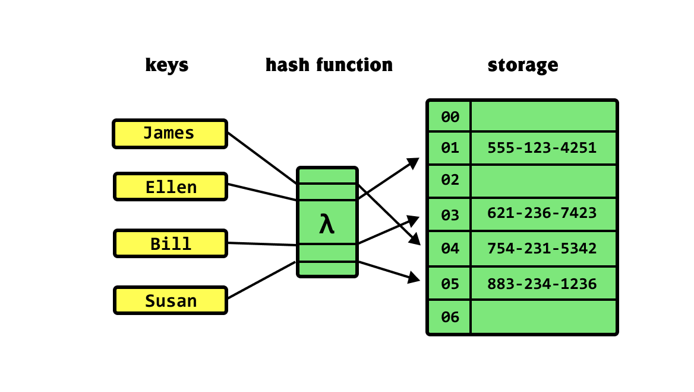
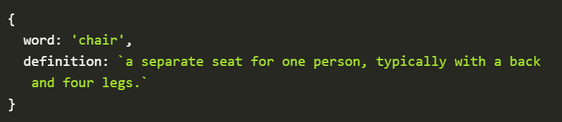
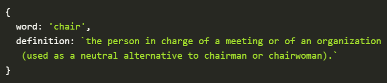

# Tablas Hash

## ¿Qué es una tabla hash?
Una tabla hash es una estructura de datos que se puede utilizar para almacenar datos en formato clave-valor con acceso directo a sus elementos en tiempo constante.

Se dice que las tablas hash son  asociativas , lo que significa que para cada clave, los datos aparecen como máximo una vez. Las tablas hash nos permiten implementar herramientas como agendas telefónicas o diccionarios; en ellas, almacenamos la asociación entre un valor (como la definición de la palabra "lámpara" en un diccionario) y su clave (la palabra "lámpara" en sí).

Podemos utilizar tablas hash para almacenar, recuperar y eliminar datos de forma única en función de su  clave única .

## ¿Por qué usar tablas Hash?
La principal ventaja de una tabla hash sobre otras estructuras de datos abstractas reside en su  rapidez  para realizar operaciones de inserción, eliminación y búsqueda. Las tablas hash pueden realizarlas todas en tiempo constante.

La principal ventaja de una tabla hash sobre otras estructuras de datos abstractas reside en su  rapidez  para realizar operaciones de inserción, eliminación y búsqueda. Las tablas hash pueden realizarlas todas en tiempo constante.

## Pares clave-valor
Independientemente de la estructura de datos primitiva subyacente que utilice para almacenar datos, para almacenar datos como un  valor  en una tabla hash, necesitamos alguna forma de identificarlo de manera única. Necesitamos una  clave .

A veces, los datos contienen una propiedad individual que puede asumir de forma natural la función de clave. Por ejemplo, si suponemos que un usertiene un emaily un userId, entonces cualquiera de los emaildos userIdpodría usarse como clave si se garantiza su unicidad.

Tomemos, por ejemplo, el caso de un diccionario. Consideremos que la definición de la palabra "  silla" en el diccionario  es la siguiente:

Si queremos almacenar esto en una tabla hash para acceder rápidamente a la definición del diccionario para la palabra, tendríamos que usar la palabra "  silla"  como clave.

Sin embargo, basándonos en este diseño, no podemos estar seguros de la unicidad. ¿Por qué? Porque en inglés existe el concepto de  homónimos : palabras que se escriben (y a veces se pronuncian) igual, pero con significados diferentes.

Por ejemplo, existe otra definición en el diccionario para la palabra silla.

Si simplemente usamos word la palabra clave, no podemos estar seguros de que sea única. Y la unicidad es importante para que la recuperación acceda a la definición proporcionando la palabra. Si tenemos dos definiciones para la misma palabra, esto probablemente deba influir en cómo estructuramos nuestros datos.

## Hash
Es una regla que mapea el Objeto en un conjunto de caracteres (código). Por lo general, ese tipo de función convierte una gran cantidad de datos en un pequeño valor entero. Las funciones hash pueden ser diferentes, pero todas presentan ciertas propiedades:

- Un objeto particular tiene el código hash particular.

- Dos objetos iguales tienen los mismos códigos hash. Lo opuesto no es verdad.
- Si dos códigos hash son diferentes, los objetos definitivamente no son iguales.
- Diferentes objetos pueden tener el mismo código hash. Este evento muy raro se llama colisión. La buena función hash minimiza la probabilidad de colisiones.

El resultado de aplicar la función Hash a un objeto llama a hashCode . 